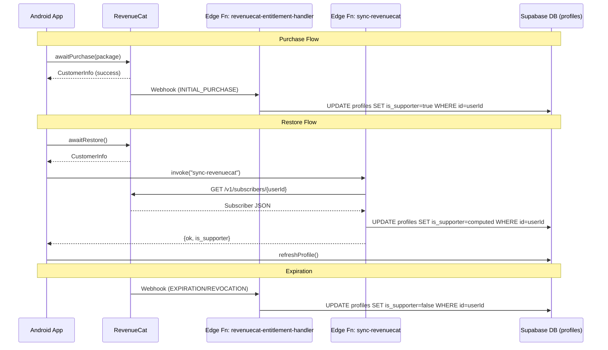

# Cozy Doubling — Technical Inventory

> **Purpose:** Specs-first, QA-driven baseline for migrating from
> Supabase + RevenueCat to a custom backend.
> Generated from the live codebase on 2026-11-20.

---

## Table of Contents

1. [Module Breakdown](#1-module-breakdown)
2. [Supabase Dependency Map](#2-supabase-dependency-map)
3. [Implicit Business Logic](#3-implicit-business-logic)
4. [Proposed Feature-File Tree](#4-proposed-feature-file-tree)
5. [Open Questions](#5-open-questions)

---

## 1. Module Breakdown

### 1.1 Auth

| Screen / Component | File | Role |
|---|---|---|
| LoginScreen | `features/auth/LoginPage.kt` | Google Native Login + Email/Password sign-in |
| LoginViewModel | `features/auth/LoginViewModel.kt` | Observes `SessionStatus`, drives nav guard |
| AppNavHost | `core/navigation/AppNavHost.kt` | Auth-gated routing: `Authenticated → Home`, `NotAuthenticated → Login` (1 s debounce) |

**User flow:** Launch → splash (waits for profile + theme) → LoginScreen ↔ HomeScreen.
On auth state change, `ProfileRepository` auto-fetches the profile and links the Supabase UID to RevenueCat via `Purchases.sharedInstance.logIn(user.id)`.

---

### 1.2 Core Feature — Focus Room

| Screen / Component | File | Role |
|---|---|---|
| FocusRoomScreen | `features/room/FocusRoomPage.kt` | Timer UI, task list, live participant cards |
| FocusRoomViewModel | `features/room/FocusRoomViewModel.kt` | Orchestrates session lifecycle, Presence/Broadcast, task CRUD |
| FocusRoomRepository | `features/room/FocusRoomRepository.kt` | Supabase Realtime channel + PostgREST session ops |
| LocalTaskDataSource | `features/room/LocalTaskDataSource.kt` | SharedPreferences cache for unfinished tasks |
| FocusRoomModels | `features/room/FocusRoomModels.kt` | DTOs: `FocusTask`, `ParticipantPresence`, `FocusSession`, `FinishSessionParams` |

**User flow:**
1. Tap "Focus" on Home → `startSession()` INSERTs a row into `focus_sessions`, triggers `send-friend-notification` Edge Function.
2. `joinRoom()` opens Realtime channel `focus-room` with Presence (key = `userId:sessionId`).
3. Task add / toggle / delete → broadcast + throttled presence track (10 s interval).
4. Blocked users filtered out via `SafetyRepository.blockedUserIds`.
5. "Finish" → `leaveRoom()` (unsubscribe), `finish_session` RPC (calculates earned leaves), navigate to Summary.

---

### 1.3 Summary (Post-Session)

| Screen / Component | File | Role |
|---|---|---|
| SummaryScreen | `features/summary/SummaryPage.kt` | Display minutes, tasks, leaves earned |
| SummaryViewModel | `features/summary/SummaryViewModel.kt` | Fetches the finished `focus_sessions` row by ID |

**User flow:** Receives `sessionId` via nav arg → `fetchSession()` SELECT from `focus_sessions` → renders stats → "Continue" pops to Home.

---

### 1.4 Friends / Social

| Screen / Component | File | Role |
|---|---|---|
| FriendsPage (tab inside OasisScreen) | `features/friends/FriendsPage.kt` | Friends list, incoming requests, add-by-tag |
| FriendsViewModel | `features/friends/FriendsViewModel.kt` | Delegates to FriendsRepository + SafetyRepository |
| FriendsRepository | `features/friends/FriendsRepository.kt` | PostgREST queries on `friendships`, `friend_stories` (view), `profiles` |
| FriendsModels | `features/friends/FriendsModels.kt` | DTOs: `FriendUiState`, `Friendship`, `FriendProfileDto`, `FocusSessionDto` |

**User flow:**
- **Send request:** Look up `profiles` by `player_tag` → check for existing `friendships` row → INSERT `friendships` with `status = 'pending'`. If incoming request already exists, auto-accepts.
- **Accept:** RPC `accept_friend(sender_id)` — sets `status = 'accepted'`, `accepted_at = now()`.
- **Reject:** RPC `reject_friend(sender_id)` — DELETEs the pending row.
- **View friends:** SELECT from `friend_stories` DB view (joins friendships + profiles + latest_sessions).

---

### 1.5 Shop / Economy

| Screen / Component | File | Role |
|---|---|---|
| ShopPage (tab inside OasisScreen) | `features/shop/ShopPage.kt` | Theme cards + Supporter Pass section |
| ShopViewModel | `features/shop/ShopViewModel.kt` | Combines EconomyRepository items + BillingRepository offerings |
| EconomyRepository | `core/economy/EconomyRepository.kt` | PostgREST queries: `items`, `theme_details`, `user_inventory`; RPCs: `buy_item`, `equip_item` |
| ShopModels | `features/shop/ShopModels.kt` | `ShopItemUiState` sealed class: `Theme`, `Pass`, `SupporterSection` |

**User flow:**
- **Buy theme with leaves:** RPC `buy_item(target_item_id)` — deducts leaves, inserts into `user_inventory`.
- **Buy Supporter Pass:** RevenueCat `awaitPurchase()` → webhook or restore → `profiles.is_supporter` updated.
- **Equip theme:** RPC `equip_item(target_item_id)` → updates `profiles.equipped_theme_id` → triggers global theme refresh.

---

### 1.6 Inventory (Theme Management)

| Screen / Component | File | Role |
|---|---|---|
| InventoryPage (tab inside OasisScreen) | `features/inventory/InventoryPage.kt` | List of owned themes, equip/unequip |
| InventoryViewModel | `features/inventory/InventoryViewModel.kt` | Filters EconomyRepository.shopItems to owned-only; RPCs: `equip_item`, `unequip_theme` |

**User flow:** View owned themes (bought + premium if supporter) → tap "Equip" → `equip_item` RPC or `unequip_theme` RPC → profile refresh → app-wide theme change.

---

### 1.7 Journey (Profile / Stats)

| Screen / Component | File | Role |
|---|---|---|
| JourneyPage (tab inside OasisScreen) | `features/journey/JourneyPage.kt` | Display username, bio, total leaves, total focus minutes |
| JourneyViewModel | `features/journey/JourneyViewModel.kt` | Maps `ProfileRepository.profile` to `ProfileUiState` |

**Data source:** `profiles.leaves`, `profiles.total_minutes_focused`, `profiles.created_at`, `profiles.display_name`.

---

### 1.8 Subscriptions / RevenueCat

| Component | File | Role |
|---|---|---|
| BillingRepository | `core/billing/BillingRepository.kt` | RevenueCat SDK: `awaitOfferings()`, `awaitPurchase()`, `awaitRestore()` |
| ProfileRepository (RC links) | `core/profile/ProfileRepository.kt` | `Purchases.logIn(uid)` on auth, `Purchases.logOut()` on sign-out, `triggerBackendRestoreSync()` |
| SettingsViewModel | `features/settings/SettingsViewModel.kt` | `onRestorePurchases()`, `onManageSubscription()` |
| **Edge Fn:** revenuecat-entitlement-handler | Uploaded: `revenuecat-entitlement-handler.ts` | Webhook: `INITIAL_PURCHASE`, `RENEWAL`, `RESTORE`, `TRANSFER` → `is_supporter = true`; `EXPIRATION`, `REVOCATION` → `is_supporter = false` |
| **Edge Fn:** sync-revenuecat | Uploaded: `sync-revenuecat.ts` | On-demand: fetches subscriber from RC API, computes `is_supporter`, updates `profiles` |

**Entitlement ID:** `"Cozy Doubling Supporter Pass"`.

---

### 1.9 Settings / Account

| Screen / Component | File | Role |
|---|---|---|
| SettingsScreen | `features/settings/SettingsPage.kt` | Update username, sign out, delete account, restore purchases, manage subscription, links |
| SettingsViewModel | `features/settings/SettingsViewModel.kt` | Delegates to ProfileRepository + BillingRepository |

**Dangerous actions:**
- **Sign out:** Clears FCM token → clears local tasks → `Supabase.client.auth.signOut()`.
- **Delete account:** RPC `delete_own_account()` → then sign out. The RPC manually cascades through inventory, friendships, sessions, profile, and finally `auth.users`.

---

### 1.10 Notifications (Push)

| Component | File | Role |
|---|---|---|
| NotificationRepository | `core/notifications/NotificationRepository.kt` | Syncs/clears FCM token to `profiles.fcm_token` |
| CozyFirebaseMessagingService | `core/notifications/CozyFirebaseMessagingService.kt` | Handles incoming FCM messages, shows system notification |
| **Edge Fn:** send-friend-notification | Uploaded: `send-friend-notification.ts` | Called on session start: finds accepted friends → fetches their `fcm_token` → sends via FCM v1 API |

---

### 1.11 Safety (Block / Report)

| Component | File | Role |
|---|---|---|
| SafetyRepository | `core/safety/SafetyRepository.kt` | PostgREST reads `user_blocks`; RPCs: `block_user`, `report_user`; Realtime on `user_blocks` table |

**Realtime publication:** Only `user_blocks` is published to `supabase_realtime`.

---

### 1.12 Theming

| Component | File | Role |
|---|---|---|
| EconomyRepository (theme state) | `core/economy/EconomyRepository.kt` | `themeState: StateFlow<ThemeState>` — fetches `theme_details` for equipped theme |
| CozyDoublingTheme | `ui/theme/Theme.kt` | Applies custom `ThemePalette` or falls back to system default |
| ThemePalette | `core/theming/ThemePalette.kt` | 18-color palette data class matching Material 3 color roles |

---

### 1.13 Profile (Shared Core)

| Component | File | Role |
|---|---|---|
| ProfileRepository | `core/profile/ProfileRepository.kt` | Central profile cache + auth observer; exposes `profile: StateFlow<Profile?>` and `syncEvents: SharedFlow<Unit>` |
| Profile model | `core/profile/ProfileModels.kt` | DTO mapping to `profiles` table |

ProfileRepository is the **reactive spine** of the app — almost every ViewModel and Repository observes `ProfileRepository.profile` or `ProfileRepository.syncEvents`.

---

### 1.14 Network / Connectivity

| Component | File | Role |
|---|---|---|
| ConnectionStateManager | `core/network/ConnectionStateManager.kt` | Singleton tracking connectivity + server errors |
| ConnectivityObserver | `core/network/ConnectivityObserver.kt` | Android `ConnectivityManager` → Flow<Boolean> |
| ConnectionErrorDialog | `core/components/ConnectionErrorDialog.kt` | Overlay error dialog |

---

## 2. Supabase Dependency Map

### 2.1 Supabase Client Configuration

```
Plugins installed: Postgrest, Auth, Realtime, Functions, ComposeAuth (Google Native)
```

### 2.2 Repository → Supabase Feature → Tables

| Repository / VM | Auth | PostgREST CRUD | PostgREST RPC | Realtime | Edge Functions | Tables / Views |
|---|:---:|:---:|:---:|:---:|:---:|---|
| **LoginViewModel** | ✅ `signInWith(Email)`, Google OAuth | | | | | `auth.users` |
| **ProfileRepository** | ✅ `sessionStatus`, `currentUserOrNull()`, `signOut()` | SELECT `profiles` ● UPDATE `profiles` (display_name, fcm_token) | `delete_own_account` | | `sync-revenuecat` | `profiles`, `auth.users` |
| **EconomyRepository** | ✅ (reads user ID) | SELECT `items` ● SELECT `theme_details` ● SELECT `user_inventory` | `buy_item` ● `equip_item` | | | `items`, `theme_details`, `user_inventory`, `profiles` |
| **FocusRoomRepository** | ✅ (reads user ID) | INSERT `focus_sessions` ● SELECT `focus_sessions` | `finish_session` | ✅ Presence (`focus-room`) ● Broadcast (`presence_update`) | `send-friend-notification` | `focus_sessions` |
| **FriendsRepository** | ✅ (reads user ID) | SELECT `profiles` ● SELECT `friendships` ● INSERT `friendships` ● SELECT `friend_stories` (view) | `accept_friend` ● `reject_friend` | | | `profiles`, `friendships`, `friend_stories` |
| **SafetyRepository** | | SELECT `user_blocks` | `block_user` ● `report_user` | ✅ Postgres Changes on `user_blocks` | | `user_blocks`, `user_reports` |
| **NotificationRepository** | ✅ (reads user ID) | UPDATE `profiles` (fcm_token) | | | | `profiles` |
| **InventoryViewModel** | | | `equip_item` ● `unequip_theme` | | | `profiles` |
| **BillingRepository** | | | | | | *(RevenueCat SDK only — no direct Supabase)* |
| **SummaryViewModel** | | SELECT `focus_sessions` | | | | `focus_sessions` |

### 2.3 All Database Tables & Views

| Table / View | Type | PK | Key FKs | Used By |
|---|---|---|---|---|
| `profiles` | Table | `id` (uuid → `auth.users.id`) | `equipped_theme_id → items.id` | ProfileRepo, EconomyRepo, FriendsRepo, NotificationRepo, SettingsVM |
| `focus_sessions` | Table | `id` (uuid) | `user_id → profiles.id` (CASCADE) | FocusRoomRepo, SummaryVM |
| `friendships` | Table | `(user_id_1, user_id_2)` composite | `user_id_1 → profiles.id` (CASCADE), `user_id_2 → profiles.id` (CASCADE), `requester_id → profiles.id` | FriendsRepo |
| `items` | Table | `id` (uuid) | `category_id → item_categories.id` | EconomyRepo, ShopVM |
| `item_categories` | Table | `id` (text) | — | *(Read-only catalog)* |
| `theme_details` | Table | `item_id` (uuid → `items.id` CASCADE) | — | EconomyRepo |
| `user_inventory` | Table | `(user_id, item_id)` composite | `user_id → auth.users.id`, `item_id → items.id` | EconomyRepo, InventoryVM |
| `user_blocks` | Table | `(blocker_id, blocked_id)` composite | `blocker_id → auth.users.id` (CASCADE), `blocked_id → auth.users.id` (CASCADE) | SafetyRepo |
| `user_reports` | Table | `id` (uuid) | `reporter_id → auth.users.id` (SET NULL), `reported_id → auth.users.id` (CASCADE) | SafetyRepo |
| `friend_stories` | **View** | — | Joins: `friendships` × `profiles` × `latest_sessions` (`security_invoker=true`) | FriendsRepo |
| `latest_sessions` | **View** | — | `DISTINCT ON (user_id)` from `focus_sessions WHERE is_processed = true ORDER BY end_time DESC` | *(used by friend_stories)* |

### 2.4 View Definitions

**`latest_sessions`** — materializes each user's most recent completed session:

```sql
SELECT DISTINCT ON (user_id)
    id, user_id, start_time, end_time, tasks_completed,
    is_processed, earned_leaves, duration_minutes, last_task_text
FROM focus_sessions
WHERE is_processed = true
ORDER BY user_id, end_time DESC;
```

**`friend_stories`** — denormalized join used by the Friends list UI (`security_invoker = true`, so it respects the calling user's RLS):

```sql
SELECT
    f.user_id_1, f.user_id_2, f.requester_id, f.status, f.accepted_at,
    p.id AS friend_id, p.display_name, p.player_tag,
    ls.duration_minutes, ls.end_time, ls.last_task_text
FROM friendships f
JOIN profiles p ON p.id = f.user_id_1 OR p.id = f.user_id_2
LEFT JOIN latest_sessions ls ON ls.user_id = p.id;
```

> [!NOTE]
> `friend_stories` uses `security_invoker = true`, meaning queries against it are subject to the
> *calling user's* RLS policies on `friendships`, `profiles`, and `focus_sessions`. Since
> `friendships` SELECT is restricted to rows where `auth.uid()` is `user_id_1` or `user_id_2`,
> and `profiles` SELECT is public (authenticated), and `focus_sessions` SELECT is owner-only,
> the view correctly returns only friends' sessions. The custom backend must replicate this
> access-scoping logic.

---

## 3. Implicit Business Logic

### 3.1 Database Triggers

| Trigger | On | Action |
|---|---|---|
| `on_auth_user_created` | `AFTER INSERT ON auth.users` | Calls `handle_new_user()`: inserts into `profiles` with `display_name` from `raw_user_meta_data->>'full_name'` and an auto-generated `player_tag` via `generate_player_tag()`. |

> [!IMPORTANT]
> The player tag generation (`generate_player_tag()`) uses a collision-retry loop over 8-char alphanumeric codes (excluding ambiguous chars `0, 1, I, O`). The custom backend must replicate this exact character set and uniqueness guarantee.

### 3.2 RLS Row-Ownership Rules

| Table | Policy | Cmd | Rule Summary |
|---|---|---|---|
| `focus_sessions` | Users can see own sessions | SELECT | `auth.uid() = user_id` |
| `focus_sessions` | Users can start sessions | INSERT | `auth.uid() = user_id` (WITH CHECK) |
| `friendships` | Users can insert friendships | INSERT | `auth.uid() = requester_id` |
| `friendships` | Users can update own friendships | UPDATE | `auth.uid() = user_id_1 OR auth.uid() = user_id_2` |
| `friendships` | Users can view their own friendships | SELECT | `auth.uid() = user_id_1 OR auth.uid() = user_id_2` |
| `profiles` | Profiles are public | SELECT | `true` (any authenticated user) |
| `profiles` | Users can update own display_name | UPDATE | Rows: `auth.uid() = id` ● **WITH CHECK prevents mutation of `leaves` and `player_tag`** — the new values must equal the existing values |
| `profiles` | Users can update own fcm_token | UPDATE | `auth.uid() = id` |
| `items` | Items are readable | SELECT | `true` (authenticated) |
| `item_categories` | Categories are readable | SELECT | `true` (authenticated) |
| `theme_details` | Theme details are readable | SELECT | `true` (authenticated) |
| `user_inventory` | Inventory is readable | SELECT | `auth.uid() = user_id` |
| `user_blocks` | Users can only block/unblock others | ALL | `auth.uid() = blocker_id` |
| `user_blocks` | Users can see blocks involving them | SELECT | `auth.uid() = blocker_id OR auth.uid() = blocked_id` |
| `user_reports` | Users can create reports | INSERT | `auth.uid() = reporter_id` |

> [!WARNING]
> **Critical RLS on `profiles` UPDATE:** The WITH CHECK clause on "Users can update own display_name" explicitly prevents clients from changing their own `leaves` or `player_tag` via direct PostgREST UPDATE. Only server-side RPCs (which run as `SECURITY DEFINER`) can modify these columns. The custom backend MUST enforce this same rule at the API level.

### 3.3 CHECK Constraints

| Table | Constraint | Rule |
|---|---|---|
| `friendships` | `friendships_status_check` | `status IN ('pending', 'accepted')` |
| `friendships` | `user_order` | `user_id_1 < user_id_2` — canonical ordering to prevent duplicate rows |

### 3.4 Cascading Deletes

| Parent | Child | On Delete |
|---|---|---|
| `auth.users` | `profiles` | CASCADE |
| `profiles` | `focus_sessions` | CASCADE |
| `profiles` | `friendships` (via user_id_1, user_id_2) | CASCADE |
| `items` | `theme_details` | CASCADE |
| `auth.users` | `user_blocks` (both columns) | CASCADE |
| `auth.users` | `user_reports.reported_id` | CASCADE |
| `auth.users` | `user_reports.reporter_id` | SET NULL |

> [!NOTE]
> `delete_own_account()` explicitly deletes from `user_inventory`, `friendships`, `focus_sessions`, `profiles`, and `auth.users` in order — even though CASCADE would handle most of these. The explicit deletion is likely a safety measure to ensure nothing is missed. The custom backend should replicate this ordered teardown.

### 3.5 SECURITY DEFINER RPCs (Server-Side Business Logic)

| Function | Key Logic |
|---|---|
| `buy_item(target_item_id)` | ① Premium items CANNOT be bought with leaves (must be supporter) ② Already-owned check ③ Insufficient-leaves check ④ Atomic: deducts leaves + inserts inventory in one transaction |
| `equip_item(target_item_id)` | ① Ownership check OR (is_premium AND is_supporter) ② Item must be in category `'theme'` ③ Updates `profiles.equipped_theme_id` |
| `finish_session(session_id, tasks_done, task_text)` | ① Ownership + not-already-processed check ② **Leaf formula:** `earned = (duration_minutes × 1) + (tasks_done × 3)`, minimum 1 ③ Atomically updates session + increments `profiles.leaves` and `profiles.total_minutes_focused` |
| `accept_friend(sender_id)` | Sets `status = 'accepted'`, `accepted_at = now()` where the row is pending and involves both users |
| `reject_friend(sender_id)` | Deletes pending friendship row (handles canonical id ordering) |
| `delete_own_account()` | Ordered cascade: inventory → friendships → sessions → profile → auth.users |
| `block_user(target_id)` | Inserts into `user_blocks` with `ON CONFLICT DO NOTHING` |
| `report_user(target_id, report_reason)` | Inserts into `user_reports` |
| `unequip_theme()` | Sets `profiles.equipped_theme_id = NULL` |
| `generate_player_tag()` | Generates unique 8-char tag from charset `23456789ABCDEFGHJKLMNPQRSTUVWXYZ` |

> [!CAUTION]
> **Leaf Economy Formula** (enforced server-side only):
> ```
> earned_leaves = (duration_minutes × 1) + (tasks_completed × 3)
> minimum = 1
> ```
> `duration_minutes` is computed server-side as `EXTRACT(EPOCH FROM (now() - start_time)) / 60`.
> The client has NO say in the duration — it is derived from the server timestamps. This is a critical anti-cheat measure.

### 3.6 RevenueCat Entitlement Flow



### 3.7 Realtime Channels

| Channel | Type | Purpose |
|---|---|---|
| `focus-room` | Presence + Broadcast | Live co-working: who's in the room, their active task, completed count |
| `safety-updates` | Postgres Changes (`user_blocks`) | Instant block list refresh when a block is added/removed |

### 3.8 Edge Functions

| Function | Trigger | Auth | Key Dependencies |
|---|---|---|---|
| `revenuecat-entitlement-handler` | RevenueCat webhook (POST) | Custom `REVENUECAT_WEBHOOK_AUTH` header | Service role key → `profiles` table |
| `sync-revenuecat` | App invocation (on restore) | Bearer token (user JWT) | Service role key → RevenueCat API → `profiles` table |
| `send-friend-notification` | App invocation (on session start) | Bearer token (user JWT) | Service role key → `friendships`, `profiles` → FCM v1 API via `FIREBASE_SERVICE_ACCOUNT` |

---

## 4. Proposed Feature-File Tree

```
specs/
├── 00_inventory.md                          ← (this file)
│
└── features/
    ├── auth/
    │   ├── google_sign_in.feature
    │   ├── email_sign_in.feature
    │   ├── session_persistence.feature
    │   └── sign_out.feature
    │
    ├── profile/
    │   ├── auto_creation_on_signup.feature   ← trigger: handle_new_user
    │   ├── player_tag_generation.feature
    │   ├── update_display_name.feature
    │   ├── view_profile_stats.feature
    │   └── delete_account.feature
    │
    ├── focus_room/
    │   ├── start_session.feature
    │   ├── task_management.feature           ← add, toggle, delete, local persistence
    │   ├── finish_session.feature            ← leaf formula, server-side duration
    │   ├── realtime_presence.feature         ← join, see others, leave
    │   ├── realtime_broadcast.feature        ← instant task updates to peers
    │   └── friend_notification_on_join.feature
    │
    ├── summary/
    │   └── session_summary.feature
    │
    ├── friends/
    │   ├── send_friend_request.feature       ← player_tag lookup, canonical ordering
    │   ├── accept_friend_request.feature
    │   ├── reject_friend_request.feature
    │   ├── view_friends_list.feature         ← friend_stories view
    │   └── view_pending_requests.feature
    │
    ├── shop/
    │   ├── view_shop_items.feature
    │   ├── buy_theme_with_leaves.feature     ← buy_item RPC, balance check
    │   ├── buy_supporter_pass.feature        ← RevenueCat purchase flow
    │   └── restore_purchases.feature         ← sync-revenuecat edge fn
    │
    ├── inventory/
    │   ├── view_owned_themes.feature         ← includes premium-if-supporter logic
    │   ├── equip_theme.feature               ← equip_item RPC
    │   └── unequip_theme.feature             ← unequip_theme RPC
    │
    ├── subscriptions/
    │   ├── revenuecat_webhook.feature        ← entitlement handler edge fn
    │   ├── supporter_status_sync.feature     ← is_supporter flag lifecycle
    │   └── manage_subscription.feature       ← deep link to Play Store
    │
    ├── safety/
    │   ├── block_user.feature                ← block_user RPC + realtime refresh
    │   ├── report_user.feature               ← report_user RPC
    │   └── blocked_users_filtering.feature   ← filtered from friends + room
    │
    ├── notifications/
    │   ├── fcm_token_sync.feature
    │   ├── receive_friend_focus_notification.feature
    │   └── token_clear_on_logout.feature
    │
    └── theming/
        ├── apply_custom_theme.feature        ← theme_details fetch + Material 3
        ├── default_theme_fallback.feature
        └── sticky_theme_cache.feature        ← prevents flicker during refresh
```

**Total: 34 `.feature` files across 11 modules.**

---

## 5. Open Questions — Resolved

| # | Question | Resolution |
|---|---|---|
| 1 | `friend_stories` / `latest_sessions` view SQL | ✅ **Resolved.** View definitions added to §2.4. `friend_stories` uses `security_invoker=true`. |
| 2 | Duplicate `finish_session` overload (2-param vs 3-param) | ✅ **Not important.** Treat the 3-param version `(session_id, tasks_done, task_text)` as canonical — it updates `total_minutes_focused` and stores `last_task_text`. The 2-param overload is legacy. |
| 3 | RevenueCat IAP product IDs | ✅ **Not relevant** to feature extraction. IAP IDs are a deployment config concern, not a behavioral spec. |
| 4 | Oasis screen structure | ✅ **Resolved.** Oasis is a UI container only — sub-tabs (Friends, Shop, Inventory, Journey) are treated as separate modules in this inventory. |
| 5 | `profiles` UPDATE RLS potential conflict | ⚠️ **Unknown — flagged as risk.** Two permissive UPDATE policies exist. In Postgres, if *any* permissive policy passes, the operation is allowed. The `fcm_token` policy's WITH CHECK (`auth.uid() = id`) has no column restriction, which may allow a crafted client to UPDATE `leaves` or `is_supporter` directly. **Recommendation:** The custom backend API should explicitly whitelist mutable columns per endpoint (only `display_name` and `fcm_token` via client-facing UPDATE). |
| 6 | Realtime for `user_blocks` | ✅ **WebSocket push required.** The custom backend must support real-time push (Supabase Realtime–style) for `user_blocks` changes so blocked users are filtered from the Focus Room and Friends list instantly. |
